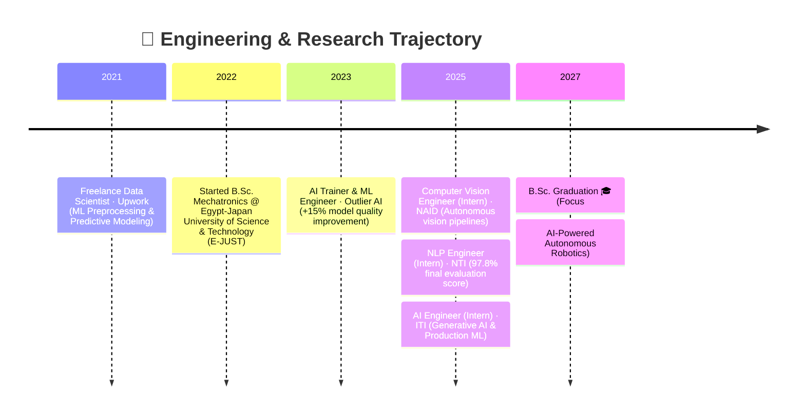

<!-- ================================================================= -->
<!-- 🚀 ALI KHALID — ADVANCED ANIMATED & COLORED GITHUB PROFILE README -->
<!-- ================================================================= -->

<div align="center">

  <!-- 🌟 Animated Neon Hero Banner -->
  <a href="https://github.com/Alouakhalid">
    
  </a>

  <br/><br/>

  <!-- ⚡ Dynamic Animated Typing SVG -->
  <a href="https://github.com/Alouakhalid">
    
  </a>

  <br/>

  <!-- 🏷️ Live Metric & Status Badges -->
  <p>
    
    
    
    
    
  </p>

  <!-- 🌐 Social Connections -->
  <p>
    <a href="https://linkedin.com/in/ali-khalid-ali-khalid-85468225b" target="_blank">
      
    </a>
    <a href="https://huggingface.co/Ali0044" target="_blank">
      
    </a>
    <a href="https://imaginative-faun-0a2cf4.netlify.app" target="_blank">
      
    </a>
    <a href="https://github.com/Alouakhalid" target="_blank">
      
    </a>
    <a href="mailto:ali88883737@gmail.com">
      
    </a>
  </p>

  <!-- 🌈 Glowing Neon Divider -->
  

</div>

<br/>

<!-- ================================================================= -->
<!-- 👨‍💻 ABOUT ME & DEVELOPER TERMINAL                                 -->
<!-- ================================================================= -->

## 💻 System Diagnostics & Developer Profile

<table>
<tr>
<td width="58%" valign="top">

```python
class AliKhalid:
    def __init__(self):
        self.role       = "AI Engineer & Deep Learning Researcher"
        self.location   = "Cairo, Egypt 🇪🇬"
        self.education  = "B.Sc. Mechatronics @ E-JUST (2022 – 2027)"
        self.experience = "4+ years · Outlier AI · NTI · NAID · ITI · Upwork"
        self.specialties = [
            "NLP & Arabic OCR", "Large Language Models (LLMs)",
            "Computer Vision & Multimodal AI", "Robotic Arm Modular Control"
        ]
        self.languages  = {
            "Arabic": "Native 🇪🇬",
            "English": "Fluent 🇬🇧",
            "Japanese": "Proficient 🇯🇵"
        }

    def current_mission(self):
        return {
            "flagship": "Qalam-Net V2 — 35,800+ downloads on 🤗 Hugging Face",
            "thesis": "Modular Control System for Robotic Arms (+15% precision)",
            "contest": "ECPC Finalist (Rank 61 / 600+ teams)",
            "status": "Available for High-Impact AI Research & Engineering"
        }

ali = AliKhalid()
print(ali.current_mission())
```

</td>
<td width="42%" align="center" valign="middle">

  

  <br/>

  

</td>
</tr>
</table>

<div align="center">
  
</div>

<br/>

<!-- ================================================================= -->
<!-- 🚀 FEATURED OPEN-SOURCE & HUGGING FACE MODELS                    -->
<!-- ================================================================= -->

## 🚀 Flagship Projects & Hugging Face Models

<div align="center">

| Project & Model | Category | Architecture / Tech | Highlights & Links |
| :--- | :---: | :---: | :--- |
| **🔥 [Qalam-Net V2](https://huggingface.co/Ali0044/Qalam_Net_V2)** | Arabic Printed OCR | `TrOCR 0.3B` • PyTorch • Vision | 📈 **35,800+ Downloads** on Hugging Face. State-of-the-art printed Arabic OCR. |
| **✍️ [Qalam-Net](https://huggingface.co/Ali0044/Qalam-Net)** | Handwritten OCR | `TrOCR` • Vision Encoder-Decoder | End-to-end Arabic handwritten document and calligraphy text extraction. |
| **🌐 [LinguaFlow](https://huggingface.co/Ali0044/LinguaFlow)** | Machine Translation | `Seq2Seq` • Transformers • NLP | Multilingual neural translation engine optimized for low-resource pairs. |
| **🩺 [Qwen Medical Chatbot](https://huggingface.co/Ali0044/qwen-medical-chatbot)** | Clinical QA LLM | `Qwen` • LoRA • SFT • PEFT | Fine-tuned reasoning model providing clinical diagnostics guidance. |
| **🦾 [Robotic Arm Controller](https://github.com/Alouakhalid)** | Mechatronics & AI | `C++` • `ROS` • Kinematics | E-JUST Bachelor Thesis: Modular control with **+15% precision improvement**. |
| **🤖 [Alissa / Multimodal Bot](https://github.com/Alouakhalid)** | AI Assistant | `Streamlit` • `Gemini` • `LangChain` | Full-stack interactive assistant supporting multimodal voice, code, & vision. |

<br/>

<a href="https://huggingface.co/Ali0044" target="_blank">
  
</a>

</div>

<br/>

<div align="center">
  
</div>

<br/>

<!-- ================================================================= -->
<!-- 🛠️ TECH ARSENAL & SKILLS MATRIX                                  -->
<!-- ================================================================= -->

## 🛠️ Comprehensive Tech Arsenal

<div align="center">

### 🧠 Machine Learning & Deep Learning


<br/>

### 💬 NLP, LLMs & Generative AI
<p>
  
  
  
  
  
  
  
  
</p>

### 👁️ Computer Vision & Multimodal
<p>
  
  
  
  
  
  
</p>

### 🦾 Robotics, Embedded Systems & Hardware

<br/>
<p>
  
  
  
  
  
</p>

### ⚙️ DevOps, Cloud & Development Workflow


</div>

<br/>

<div align="center">
  
</div>

<br/>

<!-- ================================================================= -->
<!-- 💼 CAREER JOURNEY & TIMELINE                                     -->
<!-- ================================================================= -->

## 💼 Career Journey & Professional Experience



<details>
<summary><b>📂 Expand Complete Experience & Impact Record</b></summary>
<br/>

| Role | Organization | Duration | Impact & Responsibilities |
| :--- | :--- | :--- | :--- |
| **AI Trainer & ML Engineer** | Outlier AI | Jan 2023 – Present | Boosted complex reasoning accuracy by **+15%**; trained LLMs in coding, RLHF, and structured prompt engineering. |
| **Freelance Data Scientist** | Upwork | Jun 2021 – Present | Delivered custom computer vision, machine learning models, ETL pipelines, and client data solutions. |
| **NLP Engineer (Intern)** | National Telecommunication Institute (NTI) | Aug 2025 | Developed end-to-end text classification, translation, and sentiment analysis; achieved **97.8% evaluation score**. |
| **Computer Vision Engineer (Intern)** | National Academy of Information Tech for PWD (NAID) | Jul – Sep 2025 | Built real-time assistive vision systems, object detection pipelines, and embedded model inference. |
| **AI Engineer (Intern)** | Information Technology Institute (ITI) | Aug 2025 | Built enterprise Generative AI workflows, fine-tuned transformer models, and containerized deployments. |

</details>

<br/>

<div align="center">
  
</div>

<br/>

<!-- ================================================================= -->
<!-- 🏆 HONORS, COMPETITIONS & CERTIFICATIONS                         -->
<!-- ================================================================= -->

## 🏆 Honors, Competitions & Certifications

<div align="center">

  <p>
    
    
  </p>

  <p>
    
    
    
    
    
    
  </p>

</div>

<br/>

<div align="center">
  
</div>

<br/>

<!-- ================================================================= -->
<!-- 📊 GITHUB ANALYTICS & ACTIVITY WAVEFORM                          -->
<!-- ================================================================= -->

## 📊 Live GitHub Analytics & Metrics

<div align="center">

  
  &nbsp;
  

  <br/><br/>

  
  &nbsp;
  

  <br/><br/>

  <!-- 🏆 Verified Achievements & Trophies Showcase -->
  

  <br/><br/>

  

</div>

<br/>

<div align="center">
  
</div>

<br/>

<!-- ================================================================= -->
<!-- 🧊 3D CONTRIBUTION UNIVERSE                                       -->
<!-- ================================================================= -->

## 🧊 3D Contribution Universe

<div align="center">

  

</div>

<br/>

<div align="center">
  
</div>

<br/>

<!-- ================================================================= -->
<!-- 🐍 CONTRIBUTION SNAKE EATER                                       -->
<!-- ================================================================= -->

## 🐍 Contribution Snake Eater

<div align="center">

  

</div>

<br/>

<div align="center">
  
</div>

<br/>

<!-- ================================================================= -->
<!-- 💬 INSPIRING TECH QUOTE & CONNECT                                 -->
<!-- ================================================================= -->

## 💬 Quote of the Moment

<div align="center">

  

  <br/><br/>

  

  <br/>

  <p>
    📬 <b>Direct Email:</b> <a href="mailto:ali88883737@gmail.com">ali88883737@gmail.com</a> &nbsp;•&nbsp; 📍 <b>Cairo, Egypt</b> &nbsp;•&nbsp; 🎓 <b>E-JUST</b>
  </p>

  <br/>

  <!-- 🌊 Animated Neon Wave Footer -->
  

</div>
