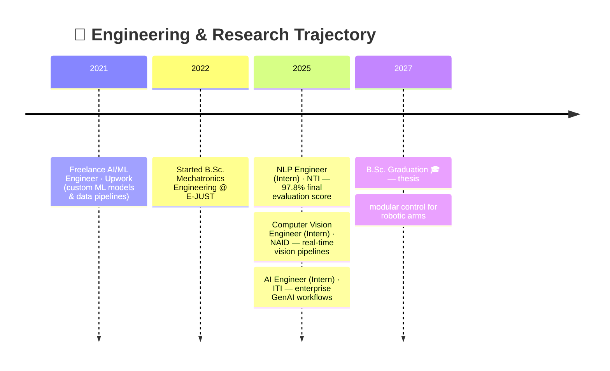
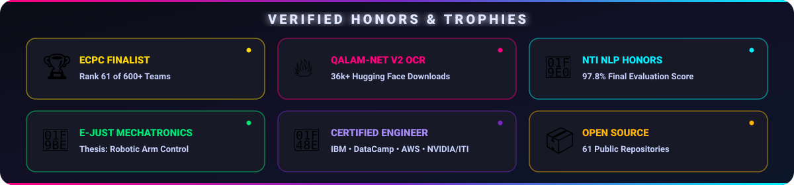

<!-- =================================================================== -->
<!-- 🚀 ALI KHALID — ANIMATED GITHUB PROFILE README (verified edition)  -->
<!-- =================================================================== -->

<div align="center">

  <!-- 🌟 Animated Neon Hero Banner -->
  <a href="https://github.com/Alouakhalid">
    
  </a>

  <br/><br/>

  <!-- ⚡ Dynamic Animated Typing SVG -->
  <a href="https://github.com/Alouakhalid">
    
  </a>

  <br/>

  <!-- 🏷️ Live Metric & Status Badges -->
  <p>
    
    
    
    
    
  </p>

  <!-- 🌐 Social Connections -->
  <p>
    <a href="https://linkedin.com/in/ali-khalid-ali-khalid-85468225b" target="_blank">
      
    </a>
    <a href="https://huggingface.co/Ali0044" target="_blank">
      
    </a>
    <a href="https://alouakhalid.github.io/portfolio/" target="_blank">
      
    </a>
    <a href="https://github.com/Alouakhalid" target="_blank">
      
    </a>
    <a href="mailto:ali88883737@gmail.com">
      
    </a>
  </p>

  <!-- 🌈 Glowing Neon Divider -->
  

</div>

<br/>

<!-- =================================================================== -->
<!-- 👨‍💻 ABOUT ME & DEVELOPER TERMINAL                                   -->
<!-- =================================================================== -->

## 💻 System Diagnostics & Developer Profile

<table>
<tr>
<td width="58%" valign="top">

```python
class AliKhalid:
    def __init__(self):
        self.role      = "AI Engineer & Deep Learning Researcher"
        self.location  = "Cairo, Egypt 🇪🇬"
        self.education = "B.Sc. Mechatronics Engineering @ E-JUST (2022 – 2027)"
        self.focus     = [
            "NLP & Arabic OCR", "LLM Fine-Tuning (LoRA / PEFT)",
            "Computer Vision & Multimodal AI", "Robotic Arm Control Software"
        ]
        self.toolbox   = ["PyTorch", "TensorFlow", "Transformers",
                          "OpenCV", "Docker", "AWS"]

    def current_mission(self):
        return {
            "flagship": "Qalam-Net V2 — Arabic OCR on 🤗 (36k+ downloads)",
            "thesis":   "Modular control system for robotic arms @ E-JUST",
            "contest":  "ECPC Finalist — Rank 61 of 600+ teams",
            "status":   "Open to AI research & engineering opportunities"
        }

ali = AliKhalid()
print(ali.current_mission())
```

</td>
<td width="42%" align="center" valign="middle">

  

  <br/>
</td>
</tr>
</table>

<div align="center">
  
</div>

<br/>

<!-- =================================================================== -->
<!-- 🚀 FLAGSHIP HUGGING FACE MODELS                                     -->
<!-- =================================================================== -->

## 🚀 Flagship Models on Hugging Face

<div align="center">
  
</div>

<div align="center">

| Model | Task | Architecture / Tech | Live Stats & Links |
| :--- | :---: | :---: | :--- |
| **🖋️ [Qalam-Net V2](https://huggingface.co/Ali0044/Qalam_Net_V2)** | Arabic Printed OCR | `TrOCR 0.3B` • ViT Encoder + RoBERTa Decoder • PyTorch |  |
| **✍️ [Qalam-Net](https://huggingface.co/Ali0044/Qalam-Net)** | Arabic Handwritten OCR | `TrOCR` • Vision Encoder-Decoder | End-to-end handwritten Arabic text extraction |
| **🌐 [LinguaFlow](https://huggingface.co/Ali0044/LinguaFlow)** | Machine Translation | `Seq2Seq` Transformer • NLP | Multilingual neural translation (EN / AR / JA) |
| **🩺 [Qwen Medical Chatbot](https://huggingface.co/Ali0044/qwen-medical-chatbot)** | Clinical QA | `Qwen` • LoRA • SFT • PEFT | Domain fine-tuned clinical reasoning assistant |

<br/>

<a href="https://huggingface.co/Ali0044" target="_blank">
  
</a>

</div>

<br/>

<div align="center">
  
</div>

<br/>

<!-- =================================================================== -->
<!-- 🧩 FEATURED OPEN-SOURCE PROJECTS                                    -->
<!-- =================================================================== -->

## 🧩 Featured Open-Source Projects

<div align="center">
  
</div>

<div align="center">

| Project | What It Does | Tech |
| :--- | :--- | :---: |
| **🧊 [AI Rubik's Cube Agent](https://github.com/Alouakhalid/ai-rubiks-cube-agent)** | Autonomous 3D Rubik's Cube solver driven by an agentic LLM | `Groq Qwen 2.5 32B` • `Kociemba` • `RAG` • `Three.js` |
| **🧠 [NeuralLens](https://github.com/Alouakhalid/NeuralLens)** | Real-time continual-learning image captioning platform | `ViT` • `GPT-2` • `Continual Learning` |
| **𓂀 [KhemetCode AI](https://github.com/Alouakhalid/KhemetCode-AI)** | Egyptian-inspired text-to-code transformer with chat UI & training studio | `Transformers` • `NLP` |
| **⚔️ [Tar Attack Judge](https://github.com/Alouakhalid/Tar_Attack_Judge)** | AI red-teaming arena: AttackBot vs TargetBot with JudgeBot feedback | `LLMs` • `Streamlit` |
| **🪪 [Egypt ID OCR](https://github.com/Alouakhalid/Egypt-ID-OCR)** | Arabic OCR pipeline for Egyptian national ID cards | `OpenCV` • `OCR` |
| **🦾 [Cubic Spline Robot Path](https://github.com/Alouakhalid/cubic-spline-path-of-robot-)** | C²-continuous cubic-spline trajectory planning for robotic arms | `Python` • `Kinematics` |
| **🛡️ [AegisTrace](https://github.com/Alouakhalid/AegisTrace)** | Autonomous AI security-intelligence & verified-remediation platform | `AI Agents` • `Security` |
| **📊 [Data Engineering Materials](https://github.com/Alouakhalid/Data-Engineering-Material-and-Projects)** | Structured data-engineering notes, labs & hands-on projects | `SQL` • `ETL` • `Pipelines` |

</div>

<br/>

<div align="center">
  
</div>

<br/>

<!-- =================================================================== -->
<!-- 🛠️ TECH ARSENAL & SKILLS MATRIX                                     -->
<!-- =================================================================== -->

## 🛠️ Tech Arsenal

<div align="center">

### 🧠 Machine Learning & Deep Learning

<br/>


<br/>

### 💬 NLP, LLMs & Generative AI
<p>
  
  
  
  
  
  
</p>

### 👁️ Computer Vision & Multimodal
<p>
  
  
  
  
  
</p>

### 🦾 Robotics, Data & Engineering Workflow

<br/>
<p>
  
  
  
  
</p>

</div>

<br/>

<div align="center">
  
</div>

<br/>

<!-- =================================================================== -->
<!-- 💼 CAREER JOURNEY & TIMELINE                                        -->
<!-- =================================================================== -->

## 💼 Career Journey



<details>
<summary><b>📂 Expand Complete Experience Record</b></summary>
<br/>

| Role | Organization | Duration | Focus |
| :--- | :--- | :--- | :--- |
| **NLP Engineer (Intern)** | National Telecommunication Institute (NTI) | Aug 2025 | Text classification, sentiment analysis & topic modeling — **97.8% evaluation score** |
| **Computer Vision Engineer (Intern)** | NAID | Jul – Sep 2025 | Real-time image processing, data pipelines & object-detection experiments |
| **AI Engineer (Intern)** | Information Technology Institute (ITI) | Aug 2025 | ML models for analysis & prediction, NLP algorithms, GenAI research |
| **AI/ML Engineer & Data Scientist (Freelance)** | Upwork | 2021 – Present | Custom ML models, preprocessing pipelines & client data solutions |

</details>

<br/>

<div align="center">
  
</div>

<br/>

<!-- =================================================================== -->
<!-- 🏆 HONORS, COMPETITIONS & CERTIFICATIONS                            -->
<!-- =================================================================== -->

## 🏆 Honors & Certifications

<div align="center">

  <p>
    
  </p>

  <p>
    
    
    
    
    
    
    
  </p>

</div>

<br/>

<div align="center">
  
</div>

<br/>

<!-- =================================================================== -->
<!-- 📊 GITHUB ANALYTICS & ACTIVITY                                      -->
<!-- =================================================================== -->

## 📊 Live GitHub Analytics

<div align="center">

  
  &nbsp;
  

  <br/><br/>

  
  &nbsp;
  

  <br/><br/>

  <!-- 🏆 Verified Achievements Showcase -->
  

  <br/><br/>

  

</div>

<br/>

<div align="center">
  
</div>

<br/>

<!-- =================================================================== -->
<!-- 🧊 3D CONTRIBUTION UNIVERSE                                         -->
<!-- =================================================================== -->

## 🧊 3D Contribution Universe

<div align="center">

  

</div>

<br/>

<div align="center">
  
</div>

<br/>

<!-- =================================================================== -->
<!-- 🐍 CONTRIBUTION SNAKE                                               -->
<!-- =================================================================== -->

## 🐍 Contribution Snake

<div align="center">

  <picture>
    <source media="(prefers-color-scheme: dark)" srcset="https://raw.githubusercontent.com/Alouakhalid/Alouakhalid/output/github-snake-dark.svg" />
    
  </picture>

</div>

<br/>

<div align="center">
  
</div>

<br/>

<!-- =================================================================== -->
<!-- 💬 QUOTE & CONNECT                                                  -->
<!-- =================================================================== -->

## 💬 Let's Build Something Intelligent

<div align="center">

  

  <br/>

  <p>
    📬 <b>Email:</b> <a href="mailto:ali88883737@gmail.com">ali88883737@gmail.com</a> &nbsp;•&nbsp; 📍 <b>Cairo, Egypt</b> &nbsp;•&nbsp; 🎓 <b>E-JUST</b>
  </p>

  <br/>

  <!-- 🌊 Animated Neon Wave Footer -->
  

</div>
