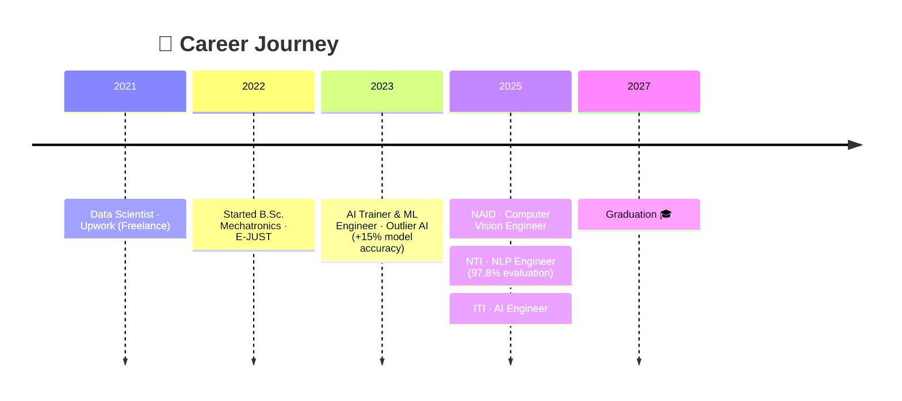
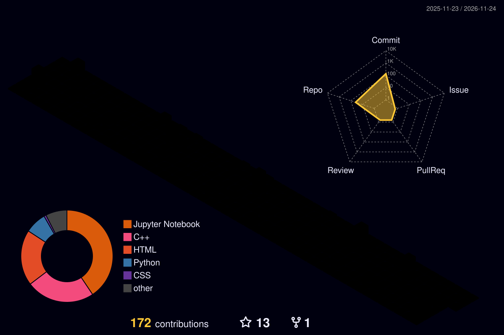

<!-- Repo must be named exactly: Alouakhalid/Alouakhalid (public). Tools used come from rzashakeri/beautify-github-profile -->


<div align="center">

<a href="https://github.com/Alouakhalid">

</a>

<br/>


<p>
<a href="https://linkedin.com/in/ali-khalid-ali-khalid-85468225b"></a>
<a href="https://huggingface.co/Ali0044"></a>
<a href="https://github.com/Alouakhalid"></a>
<a href="https://imaginative-faun-0a2cf4.netlify.app"></a>
<a href="mailto:ali88883737@gmail.com"></a>
</p>


</div>

## 👨‍💻 About Me

<table>
<tr>
<td width="55%">

```python
class AliKhalid:
    role       = "AI Engineer | Deep Learning Researcher"
    location   = "Cairo, Egypt 🇪🇬"
    education  = "B.Sc. Mechatronics @ E-JUST (2022-2027)"
    experience = "4+ yrs · Upwork · Outlier AI · NTI · NAID · ITI"
    focus      = ["NLP", "Computer Vision",
                  "Reinforcement Learning", "LLM Fine-tuning"]
    languages  = {"Arabic": "Native 🇪🇬",
                  "English": "Fluent 🇬🇧",
                  "Japanese": "Proficient 🇯🇵"}

    def now(self):
        return [
          "🔭 Building Arabic OCR & multimodal models",
          "🦾 Thesis: modular control for robotic arms (+15% precision)",
          "🏆 ECPC Finalist — Rank 61 / 600+ teams",
        ]
```

</td>
<td width="45%" align="center">


</td>
</tr>
</table>


## 🛠️ Tech Arsenal

<div align="center">

<br/>
<br/>

<br/>


<br/>

<br/>


<br/>

<br/>


</div>


## 🚀 Featured Projects · 🤗 Hugging Face

<div align="center">

<a href="https://huggingface.co/Ali0044/Qalam_Net_V2">
</a><br/>
<a href="https://huggingface.co/Ali0044/Qalam-Net">
</a><br/>
<a href="https://huggingface.co/Ali0044/LinguaFlow">
</a><br/>
<a href="https://huggingface.co/Ali0044/qwen-medical-chatbot">
</a><br/>
<br/>


<br/><br/>
<a href="https://huggingface.co/Ali0044"></a>

</div>


## 💼 Experience



<details>
<summary><b>📂 Expand full experience details</b></summary>
<br/>

| Role | Company | Period | Highlights |
|:--|:--|:--|:--|
| Data Scientist | Upwork (Freelance) | Jun 2021 – Present | Custom ML models, preprocessing pipelines, code reviews |
| AI Trainer & ML Engineer | Outlier AI | Jan 2023 – Present | +15% model accuracy in 6 months, led workshops |
| NLP Engineer (Intern) | NTI | Aug 2025 | Text classification, sentiment, topic modeling · **97.8% eval score** |
| Computer Vision Engineer (Intern) | NAID | Jul – Sep 2025 | Real-time CV, end-to-end pipelines, object detection |
| AI Engineer (Intern) | ITI | Aug 2025 | Production ML, NLP algorithms, AI research |

</details>


## 🎓 Certifications & 🏅 Achievements

<div align="center">


<br/>


</div>


## 📊 GitHub Analytics

<div align="center">


<br/>


<br/>


<br/>


</div>


## 🌆 3D Contribution Calendar & 🐍 Snake

> Both are generated automatically by the GitHub Action in `.github/workflows/profile-automation.yml`

<div align="center">




</div>


## 💬 Quote of the Moment

<div align="center">

</div>

## 🤝 Let's Connect

<div align="center">


<br/>

📧 **ali88883737@gmail.com** &nbsp;·&nbsp; 📍 Cairo, Egypt

<br/>


</div>
